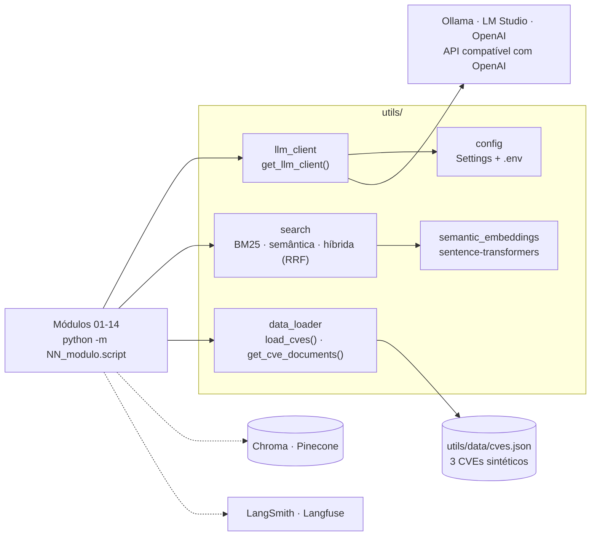

# Estudos de AI Engineering: LLMs, RAG, agentes e produção

[](https://github.com/IannCarvalho/llm-study/actions/workflows/ci.yml)
[](https://www.python.org/downloads/)
[](LICENSE)
[](https://github.com/astral-sh/ruff)

Repositório educacional com exemplos práticos e executáveis dos padrões de engenharia com LLMs: de embeddings e busca híbrida a agentes, avaliação, guardrails, memória, deploy e cache.

- **Local-first:** o LLM roda localmente via [Ollama](https://ollama.com) ou [LM Studio](https://lmstudio.ai); OpenAI é opcional e nenhuma chave é necessária para estudar.
- **Uma base de dados só:** todos os módulos usam a mesma base sintética de CVEs (`utils/data/cves.json`), para comparar técnicas sobre os mesmos dados.
- **Roda sem LLM onde dá:** buscas, métricas, guardrails, memória, cache e a API de deploy têm caminho determinístico. É isso que a suíte de testes e o CI exercitam.
- **Utilitários compartilhados** em `utils/`: cliente LLM, busca BM25/semântica/híbrida (RRF), carregamento de dados e configuração.

> Documentação em PT-BR; código, nomes e comentários em inglês (ver [CONTRIBUTING.md](CONTRIBUTING.md)).

---

## Mapa dos módulos

| Módulo | Tópicos | Roda sem LLM? | Requisitos extras | Roteiro |
|--------|---------|---------------|-------------------|---------|
| [01_vector_databases](01_vector_databases/README.md) | BM25, embeddings, chunking, busca híbrida (RRF) | Sim | modelo de embeddings, baixado no 1º uso | Day 1 |
| [02_agentic_ai_basics](02_agentic_ai_basics/README.md) | Tool use, ReAct | Não | Ollama | Day 2 |
| [03_langgraph](03_langgraph/README.md) | Fluxos lineares e condicionais (StateGraph) | Não | Ollama | Day 3 |
| [04_advanced_workflows](04_advanced_workflows/README.md) | RAG com Chroma e Pinecone, reranking com cross-encoder | Reranking: sim · RAG: não | Ollama; Pinecone exige `PINECONE_API_KEY` | Day 4 |
| [05_observability](05_observability/README.md) | LangSmith, Langfuse, tracing | Não | Ollama; chaves do LangSmith/Langfuse | Day 5 |
| [06_evals](06_evals/README.md) | Métricas offline de RAG, LLM-as-judge | Métricas: sim · juiz: não | Ollama (juiz) | Day 6 |
| [07_sdd](07_sdd/README.md) | Spec-Driven Development | Não | Ollama | Day 7 |
| [08_agentic_platforms](08_agentic_platforms/README.md) | Skills, hooks, specs, MCP, subagents (Kiro e Claude) | Conceitual | — | Day 8 |
| [09_guardrails](09_guardrails/README.md) | Prompt injection, PII, vazamento de prompt (OWASP LLM 2025) | Sim | — | Day 9 |
| [10_structured_output](10_structured_output/README.md) | JSON Schema, validação com Pydantic, retry | Parser: sim · extração: não | Ollama (extração) | Day 10 |
| [11_memory](11_memory/README.md) | Memória de curto e de longo prazo | Sim (a geração usa LLM) | — | Day 11 |
| [12_agentic_rag](12_agentic_rag/README.md) | Recuperação multi-etapa: o agente decide quando e o que buscar | Sim (a geração usa LLM) | — | Day 12 |
| [13_deployment](13_deployment/README.md) | Agente servido como API (FastAPI) com streaming SSE | Sim (fallback determinístico) | `fastapi`, `uvicorn` | Day 13 |
| [14_semantic_caching](14_semantic_caching/README.md) | Cache de respostas por similaridade da pergunta | Sim | — | Day 14 |
| [utils/](utils/) | Utilitários compartilhados | — | — | — |

Ainda só no roteiro, sem script dedicado: **Prompting** (Day 0), **MCP** (Day 2, extra) e **Context Engineering** (Day 3.5).

Os números dos diretórios são identificadores estáveis (não se renumera nada); a **ordem de estudo** é a do [roteiro](#roteiro-de-estudo).



---

## Início rápido

### Pré-requisitos
- **Python 3.11**, a versão testada no CI. O código usa sintaxe que não roda no 3.8.
- Um LLM com API compatível com a da OpenAI; o padrão é o Ollama local:
  - **Ollama** (local, grátis): https://ollama.com
  - **LM Studio** (local, grátis, com interface gráfica): https://lmstudio.ai
  - **OpenAI** (nuvem, pago): https://platform.openai.com

  Vários módulos rodam sem LLM nenhum (veja a tabela acima).

### 1. Ambiente

**Windows (PowerShell):**
```powershell
python -m venv .venv
.venv\Scripts\Activate.ps1
pip install -r requirements.txt
```

**Linux/macOS (Bash):**
```bash
python3 -m venv .venv
source .venv/bin/activate
pip install -r requirements.txt
```

### 2. LLM local (Ollama)
```bash
ollama serve          # terminal 1 (deixe rodando)
ollama pull mistral   # terminal 2, só na primeira vez
```

### 3. Arquivo `.env`
Copie o modelo (`cp .env.example .env` no Bash, `Copy-Item .env.example .env` no PowerShell). O padrão já aponta para o Ollama:

```
OLLAMA_MODEL=mistral:latest
OLLAMA_BASE_URL=http://localhost:11434/v1
OPENAI_API_KEY=ollama
```

LM Studio, OpenAI e outros provedores estão em [LLM_SETUP.md](LLM_SETUP.md).

### 4. Rodar os exemplos
Todo script roda como módulo, a partir da raiz. Os nomes das pastas começam com dígito, então `import 01_vector_databases` não funciona, mas `python -m` funciona:

```powershell
$env:PYTHONPATH = "."            # PowerShell  (Bash: export PYTHONPATH=".")

python -m 01_vector_databases.hybrid_search
python -m 09_guardrails.input_guardrails
```

O [roteiro](#roteiro-de-estudo) abaixo lista o comando de cada exemplo.

### 5. Testes e lint
```bash
python -m pytest tests -q   # suíte determinística: sem LLM, sem rede, sem download de modelo
ruff check .
```

---

## Roteiro de estudo

> Rode cada exemplo como pacote a partir da raiz (`$env:PYTHONPATH = "."` no PowerShell, `export PYTHONPATH="."` no Bash). Os comandos abaixo usam a forma `python -m`, que funciona em qualquer sistema.

### Day 0 — Fundamentos: Prompting (pré-requisito)

> **Novo tópico (conceitual + exercício).** Antes de recuperar contexto ou dar
> ferramentas ao modelo, você precisa saber pedir bem. Esta é a camada que todos
> os módulos seguintes assumem. Ainda não há script dedicado no repositório —
> comece pela leitura e faça o exercício sobre a base de CVEs.

**Conceitos:**
- Zero-shot vs. few-shot (k-shot)
- Role prompting (definir papel/persona do modelo)
- Chain-of-Thought (CoT): fazer o modelo "pensar antes de responder"
- Contrato + contraste: dizer o que fazer **e** o que não fazer
- Saída estruturada (JSON mode) para integrar com código

**Exercício prático:**
```powershell
# Compare variações de prompt sobre o MESMO CVE e observe a diferença de saída:
#   1. zero-shot:  "Resuma este CVE."
#   2. role:       "Você é um analista de segurança. Resuma este CVE para um gestor."
#   3. CoT:        "Analise passo a passo a severidade deste CVE e então conclua."
#   4. estruturado:"Responda em JSON: {id, severidade, resumo, acao_recomendada}"
# Use o utils.llm_client (get_llm_client) e um CVE de utils/data/cves.json.
```

### Day 1 — Fundamentos: bancos vetoriais

**Manhã:**
```powershell
# Busca por palavra-chave (BM25) e, em seguida, embeddings
python -m 01_vector_databases.embeddings_basics
python -m 01_vector_databases.chunking_strategies
```

**Tarde:**
```powershell
# Tudo junto na busca híbrida (palavra-chave + semântica + RRF)
python -m 01_vector_databases.hybrid_search
# Leia: 01_vector_databases/README.md
```

### Day 2 — Agentes: padrões simples

**Manhã:**
```powershell
# ReAct: raciocínio + ação
python -m 02_agentic_ai_basics.react_pattern
```

**Tarde:**
```powershell
# Tool use: function calling
python -m 02_agentic_ai_basics.tool_use
# Leia: 02_agentic_ai_basics/README.md
```

**Extra — MCP (Model Context Protocol):**

> **Novo tópico (conceitual + exercício).** Function calling cru é o "antes";
> o MCP é o padrão de fato (Anthropic, OpenAI e esta própria stack usam) para
> expor ferramentas, recursos e prompts a um agente de forma padronizada e
> reutilizável — em vez de reimplementar o wiring de tool use a cada projeto.

**Conceitos:**
- Por que padronizar a interface agente ↔ sistema (ACI — Agent-Computer Interface)
- Server / Client / Resource / Prompt
- Como nomear e desenhar boas tools (nomes claros, escopo mínimo, erros úteis)

**Exercício prático:**
```powershell
# Exponha o seu utils.tools.search_cve como um MCP server mínimo e chame-o
# por um cliente MCP — reaproveitando a MESMA base de CVEs dos outros módulos.
```

### Day 3 — Orquestração: LangGraph

**Manhã:**
```powershell
# Máquinas de estado com LangGraph: pipeline linear
python -m 03_langgraph.langgraph_basics
```

**Tarde:**
```powershell
# Roteamento condicional (fluxos com vários caminhos)
python -m 03_langgraph.langgraph_conditional
# Leia: 03_langgraph/README.md
```

### Day 3.5 — Context Engineering (novo)

> **Novo tópico (conceitual + exercício).** Depois de orquestrar fluxos
> (LangGraph) e antes de RAG de produção, entenda **engenharia de contexto** — a
> skill que substituiu "prompt engineering" como diferencial sênior em AI
> Engineering. Você já pratica partes dela sem nomear: RAG é *Select*,
> observabilidade ajuda a enxergar *context rot*.

**Conceitos:**
- Janela de contexto e por que o mecanismo de atenção não escala
- *Context rot* e *lost in the middle* (informação no meio do contexto é ignorada)
- 4 modos de falha: *poisoning*, *distraction*, *confusion*, *clash*
- As 4 estratégias: **Write, Select, Compress, Isolate**

**Exercício prático:**
```powershell
# Demonstre "context distraction" com o SEU dado:
#   1. Pergunte sobre um CVE específico passando só ele no contexto.
#   2. Repita inflando o contexto com dezenas de CVEs irrelevantes.
#   3. Compare qualidade/latência das respostas — veja a degradação.
# Reutilize utils.data_loader para montar os dois cenários.
```

### Day 4 — RAG com bancos vetoriais de produção

**Manhã:**
```powershell
# RAG com banco vetorial local (Chroma)
python -m 04_advanced_workflows.chroma_rag
```

**Tarde:**
```powershell
# RAG com banco vetorial na nuvem (Pinecone — exige PINECONE_API_KEY)
python -m 04_advanced_workflows.pinecone_rag
# Reranking com cross-encoder depois da busca híbrida (usa sentence-transformers; degrada sem ele)
python -m 04_advanced_workflows.reranking
# Leia: 04_advanced_workflows/README.md
```

### Day 5 — Observabilidade: depuração e monitoramento

**O dia todo:**
```powershell
# Monitore e rastreie seus agentes
python -m 05_observability.langsmith_demo
python -m 05_observability.langfuse_demo
# Leia: 05_observability/README.md
```

**Prática avançada:** monte seus próprios fluxos combinando o que viu até aqui: experimente, modifique o código, entenda a fundo.

### Day 6 — Avaliação: medindo qualidade

**Manhã:**
```powershell
# Métricas offline de retrieval (determinísticas, não precisam de Ollama)
python -m 06_evals.rag_metrics
```

**Tarde:**
```powershell
# LLM-as-judge: pontuar a saída gerada com um segundo LLM (precisa de Ollama)
python -m 06_evals.llm_as_judge
# Leia: 06_evals/README.md
```

### Day 7 — Spec-Driven Development

**O dia todo:**
```powershell
# A spec guia e valida a saída do agente (com spec vs. sem spec)
python -m 07_sdd.spec_driven_analysis
# Leia: 07_sdd/README.md e 07_sdd/spec_example.md
```

### Day 8 — Trabalhando com plataformas agênticas (Kiro e Claude)

**O dia todo:**
```powershell
# Módulo conceitual — sem script para rodar.
# Leia: 08_agentic_platforms/README.md
#   Skills, Hooks, Specs/Steering, MCP tools, Subagents
```

### Day 9 — Guardrails e segurança

**O dia todo:**
```powershell
# Os dois rodam sem Ollama (guardrails determinísticos)
python -m 09_guardrails.input_guardrails    # bloqueia injection / PII antes do LLM
python -m 09_guardrails.output_guardrails   # pega vazamento de prompt / fuga de escopo
# Leia: 09_guardrails/README.md
```

### Day 10 — Saída estruturada confiável

**O dia todo:**
```powershell
# Autoteste determinístico do helper parse-validate-retry (sem Ollama):
python -m 10_structured_output.retry_parser
# Extração com schema e retry (precisa de Ollama):
python -m 10_structured_output.schema_extraction
# Leia: 10_structured_output/README.md
```

### Day 11 — Memória

**O dia todo:**
```powershell
# Janela curta + gatilho de sumarização (sem Ollama):
python -m 11_memory.memory_store
# Recall semântico de longo prazo (a recuperação roda sem Ollama):
python -m 11_memory.long_term_memory
# Leia: 11_memory/README.md
```

### Day 12 — Agentic RAG: recuperação multi-etapa

**O dia todo:**
```powershell
# O agente decompõe uma pergunta composta, encadeia buscas e acumula evidência.
# Decisão + recuperação rodam sem Ollama (a geração degrada com elegância):
python -m 12_agentic_rag.agentic_rag
# Leia: 12_agentic_rag/README.md
```

### Day 13 — Deployment: o agente como API com streaming

**O dia todo:**
```powershell
# Dependências do módulo (não vêm no requirements.txt):
pip install fastapi uvicorn
# Sobe a API em http://127.0.0.1:8000 (sem Ollama, cai no fallback de busca híbrida):
python -m 13_deployment.serve
# Em outro terminal: GET /health, POST /query e o streaming SSE em /stream
curl http://127.0.0.1:8000/health
# Leia: 13_deployment/README.md (endpoints, SSE e a nota de segurança sobre 127.0.0.1)
```

### Day 14 — Cache semântico

**O dia todo:**
```powershell
# Cache por similaridade da pergunta: paráfrase vira HIT, tópico distante vira MISS (sem Ollama)
python -m 14_semantic_caching.semantic_cache
# Leia: 14_semantic_caching/README.md (o tradeoff do threshold)
```

---

## Configuração (`.env`)

Todas as configurações do projeto ficam em `utils/config.py` (Pydantic Settings). Cada variável é lida do ambiente ou do `.env`; o modelo completo, com comentários, está em [.env.example](.env.example).

| Variável | Padrão | Para quê |
|----------|--------|----------|
| `OLLAMA_MODEL` | `mistral` | Nome do modelo no endpoint, seja Ollama, LM Studio ou OpenAI |
| `OLLAMA_BASE_URL` | `http://localhost:11434/v1` | URL de **qualquer** endpoint compatível com OpenAI (o prefixo `OLLAMA_` vem do padrão) |
| `OPENAI_API_KEY` | `ollama` | Chave da API; o Ollama ignora o valor |
| `LLM_TEMPERATURE` | `0.7` | Temperatura padrão do `get_llm_client()` (0.0–2.0) |
| `LLM_MAX_TOKENS` | `512` | Limite padrão de tokens da resposta (1–4096) |
| `CHROMA_PATH` | `./data/chroma` | Pasta do Chroma local (criada pelo `chroma_rag`) |
| `PINECONE_API_KEY` | — | Chave do Pinecone (só o `pinecone_rag` usa) |
| `HF_TOKEN` | — | Token do Hugging Face (opcional, para baixar modelos) |
| `DEBUG` | `false` | Liga também o log em arquivo, em `./logs` |
| `LOG_LEVEL` | `INFO` | Nível de log |

Lidas diretamente pelas bibliotecas de observabilidade, não pelo `Settings`: `LANGCHAIN_TRACING_V2`, `LANGCHAIN_API_KEY` e `LANGCHAIN_PROJECT` (LangSmith); `LANGFUSE_PUBLIC_KEY`, `LANGFUSE_SECRET_KEY` e `LANGFUSE_BASE_URL` (Langfuse).

Não existe `OPENAI_MODEL`: o modelo é sempre `OLLAMA_MODEL`, inclusive na OpenAI. Para trocar de provedor, veja [LLM_SETUP.md](LLM_SETUP.md).

---

## Base de dados: CVEs sintéticos

Todos os exemplos usam `utils/data/cves.json`, com **3 registros sintéticos**: uma RCE, uma SQL injection e uma fraqueza criptográfica, em produtos fictícios como "WebServer v2.1". Os IDs seguem o formato real e podem coincidir com CVEs de verdade de outros produtos.

```python
from utils.data_loader import get_cve_documents, load_cves

cves = load_cves()                # lista de CVEData (id, severity, score, description, ...)
documents = get_cve_documents()   # {cve_id: texto formatado} para indexar
```

Duas coisas para interpretar os resultados:

- **A base é mínima.** Com 3 documentos dá para entender cada técnica, mas não para comparar retrievers: precision@k e reranking quase não discriminam.
- **`get_cve_documents()` acrescenta keywords sintéticas** a cada documento, conforme o `vulnerability_type` do registro (expansão de documento, para reforçar o sinal do BM25). Os documentos indexados não são o texto cru do CVE; `get_cve_documents(enrich_keywords=False)` devolve o texto cru.

---

## `utils/`: utilitários compartilhados

| Utilitário | Para quê | Uso |
|------------|----------|-----|
| `llm_client.py` | Cliente LLM único (ChatOpenAI do LangChain) | `from utils.llm_client import get_llm_client` |
| `semantic_embeddings.py` | Embeddings locais (sentence-transformers) | `from utils.semantic_embeddings import embed_text, embed_texts` |
| `search.py` | Busca BM25, semântica e híbrida (RRF) | `from utils.search import create_search_engine` |
| `chunking_utils.py` | Divisão de documentos | `from utils.chunking_utils import chunk_text` |
| `data_loader.py` | Base de CVEs | `from utils.data_loader import load_cves, get_cve_documents` |
| `tools.py` | Tool de agente (`@tool` do LangChain) | `from utils.tools import search_cve` |
| `config.py` | Configuração (`.env`) | `from utils.config import get_config` |
| `prompts/` | Prompts de sistema em `.txt` | `from utils.prompts import RAG_SYSTEM` |

### Cliente LLM

Todas as chamadas de LLM passam por `utils.llm_client`, o que permite trocar Ollama ↔ LM Studio ↔ OpenAI só pelo `.env`:

```python
from utils.llm_client import get_llm_client

client = get_llm_client()   # singleton: modelo, endpoint e temperatura vêm do .env

# Geração simples
print(client.generate("Explique RRF em uma frase."))

# Conversa, com parâmetros que valem só para esta chamada
print(client.chat(
    messages=[{"role": "user", "content": "Olá!"}],
    temperature=0.0,
    max_tokens=256,
))

# Chains LCEL do LangChain
from langchain_core.prompts import ChatPromptTemplate
llm = client.get_chat_model()   # ChatOpenAI
chain = ChatPromptTemplate.from_template("...") | llm
```

`get_llm_client()` cria a instância na **primeira** chamada; argumentos passados depois não a alteram (geram um aviso). Para valores por chamada, use os parâmetros de `chat()` e `generate()`; para outra configuração, crie um `LLMClient(...)` próprio.

---

## Estrutura do repositório

```
01_vector_databases/       # BM25, embeddings, chunking, busca híbrida
├── embeddings_basics.py   # BM25 e, depois, similaridade de embeddings
├── chunking_strategies.py # fixed-size, por sentença, recursivo
├── hybrid_search.py       # palavra-chave + semântica com RRF
└── README.md
02_agentic_ai_basics/      # padrões de agente
├── tool_use.py            # LLM chamando ferramentas
├── react_pattern.py       # ReAct: Thought → Action → Observation
└── README.md
03_langgraph/              # fluxos com LangGraph
├── langgraph_basics.py    # pipeline linear
├── langgraph_conditional.py # roteamento condicional
└── README.md
04_advanced_workflows/     # RAG com bancos vetoriais
├── chroma_rag.py          # banco vetorial local
├── pinecone_rag.py        # banco vetorial na nuvem
├── reranking.py           # reranking com cross-encoder (duas etapas)
└── README.md
05_observability/          # LangSmith e Langfuse
├── langsmith_demo.py
├── langfuse_demo.py
└── README.md
06_evals/                  # avaliação de LLM e agentes
├── rag_metrics.py         # métricas offline de retrieval (sem LLM)
├── llm_as_judge.py        # pontua a saída com um segundo LLM
└── README.md
07_sdd/                    # Spec-Driven Development
├── spec_driven_analysis.py
├── spec_example.md        # a spec como artefato legível
└── README.md
08_agentic_platforms/      # plataformas agênticas (conceitual)
└── README.md
09_guardrails/             # segurança de LLM (OWASP LLM Top 10)
├── input_guardrails.py    # bloqueia injection / PII antes do LLM
├── output_guardrails.py   # detecta vazamento de prompt / fuga de escopo
└── README.md
10_structured_output/      # saída estruturada confiável
├── schema_extraction.py   # schema Pydantic → validar → retry
├── retry_parser.py        # helper genérico parse-validate-retry
└── README.md
11_memory/                 # memória conversacional
├── memory_store.py        # janela deslizante + sumarização
├── long_term_memory.py    # recall semântico sobre a base
└── README.md
12_agentic_rag/            # recuperação multi-etapa
├── agentic_rag.py
└── README.md
13_deployment/             # o agente como API HTTP
├── serve.py               # FastAPI + streaming SSE, só em 127.0.0.1
└── README.md
14_semantic_caching/       # cache por similaridade da pergunta
├── semantic_cache.py
└── README.md
utils/                     # utilitários compartilhados
├── llm_client.py          # cliente LLM (Ollama / LM Studio / OpenAI)
├── semantic_embeddings.py # embeddings (sentence-transformers)
├── search.py              # BM25, semântica, híbrida (RRF)
├── chunking_utils.py      # estratégias de divisão de documentos
├── rag_pipeline.py        # pipeline RAG sobre Chroma (usado pelo 04)
├── data_loader.py         # carregamento da base de CVEs
├── models.py              # modelos Pydantic
├── tools.py               # tools de agente
├── agentic_utils.py       # dados de exemplo das demos
├── config.py              # configuração (.env)
├── constants.py           # constantes
├── logging.py             # logging
├── data/cves.json         # base de CVEs (sintética)
└── prompts/               # prompts de sistema (.txt)
tests/                     # suíte determinística (pytest)
.github/workflows/ci.yml   # CI: ruff + pytest
.env.example               # modelo do .env
LLM_SETUP.md               # provedores de LLM e problemas comuns
CONTRIBUTING.md            # como contribuir, convenções
requirements.txt           # dependências
pyproject.toml             # configuração do ruff e do pytest
```

`data/chroma/` é criado em tempo de execução pelo `chroma_rag` (veja `CHROMA_PATH`) e não vai para o git.

---

## Decisões de arquitetura

### Por que LangChain?
- Já integrado à observabilidade (LangSmith)
- Uma abstração única para LLMs locais e na nuvem
- Ecossistema rico para RAG, agentes e chains
- Comprovado em times de AI Engineering

### Por que Ollama?
- Custo zero de nuvem durante o desenvolvimento
- Mesma API da OpenAI (migração fácil)
- Roda modelos localmente com pouco setup
- Ideal para estudar

### Estratégia de recuperação
- **Palavra-chave (BM25):** rápido e eficaz para termos exatos ("CVE-2024-1234"); implementado com `rank-bm25`.
- **Semântica:** embeddings densos (`all-MiniLM-L6-v2`, sentence-transformers) para correspondência por significado ("execução remota de código").
- **Reciprocal Rank Fusion (RRF):** combina os dois rankings.
  - Fórmula: `score = 1/(k + rank_bm25) + 1/(k + rank_semantico)`, com `k = 60` (`RRF_K` em `utils/constants.py`)
  - Premia documentos que aparecem bem nos dois rankings
  - Um único parâmetro (`k`) e nenhum treino: não exige calibrar escalas de score diferentes
- Em produção, os mesmos embeddings vão para um banco vetorial (Chroma ou Pinecone, módulo 04).

---

## 📚 Conceitos-chave

### Agentic AI
- ✅ Padrão ReAct (Reason → Act → Observe)
- ✅ Tool use / function calling
- ✅ Máquinas de estado (LangGraph)
- ✅ Loops de agente e feedback
- ✅ Recuperação multi-etapa (12) e memória (11)

### Bancos vetoriais
- ✅ O que são embeddings
- ✅ Estratégias de chunking
- ✅ Pipeline RAG completo
- ✅ Busca semântica vs. palavra-chave
- ✅ Re-ranking e scoring

### Observabilidade e avaliação
- ✅ Integração com LangSmith / Langfuse
- ✅ Traces e spans
- ✅ Depuração de agentes
- ✅ Evals: métricas offline e LLM-as-judge (06)

### AppSec
- ✅ Defesas contra prompt injection (09)
- ✅ Validação de entrada e de saída (09, 10)
- ⬜ Rate limiting: ainda sem exemplo no repositório

### Produção
- ✅ API com streaming SSE (13)
- ✅ Cache semântico (14)

---

## Glossário

| Termo | Significado curto |
|-------|-------------------|
| BM25 | Ranking por palavra-chave (TF-IDF com saturação e normalização por tamanho) |
| Embedding | Vetor denso que representa o significado de um texto |
| RRF | Reciprocal Rank Fusion: combina rankings somando `1/(k + rank)` |
| RAG | Retrieval-Augmented Generation: recuperar contexto e gerar a resposta com ele |
| Reranking | Segunda etapa que reordena os candidatos com um modelo mais preciso (cross-encoder) |
| ReAct | Loop Thought → Action → Observation até a resposta final |
| Tool use | O modelo escolhe e chama funções (function calling) |
| MCP | Model Context Protocol: padrão para expor tools, resources e prompts a agentes |
| LLM-as-judge | Um segundo LLM avalia a saída com uma rubrica |
| Guardrail | Verificação antes/depois do LLM (injection, PII, vazamento) |
| SSE | Server-Sent Events: streaming de texto por HTTP |
| precision@k | Fração dos k primeiros resultados que são relevantes |

---

## 🐛 Problemas comuns

| Problema | Solução |
|----------|---------|
| `No module named 'utils'` | Rode a partir da raiz com `PYTHONPATH="."` (veja o [início rápido](#4-rodar-os-exemplos)) |
| `Connection refused` em `localhost:11434` | Suba o Ollama: `ollama serve` |
| `model not found` | `ollama pull mistral` e confira `OLLAMA_MODEL` no `.env` |
| `ModuleNotFoundError` | `pip install -r requirements.txt` (o 13 também precisa de `fastapi` e `uvicorn`) |
| Banco vetorial vazio ou com dados antigos | Apague `data/chroma` e rode `python -m 04_advanced_workflows.chroma_rag` de novo |

Lista completa (credenciais, versões do Python, LLM lento, testes rápidos): [LLM_SETUP.md](LLM_SETUP.md#problemas-comuns).

---

## Recursos

- [Documentação do LangChain](https://python.langchain.com/)
- [Modelos do Ollama](https://ollama.com/library)
- [Documentação do LangSmith](https://docs.smith.langchain.com/)
- [Documentação do Langfuse](https://langfuse.com/docs)

## Contribuindo e licença

Veja [CONTRIBUTING.md](CONTRIBUTING.md). Licenciado sob a [MIT License](LICENSE).
